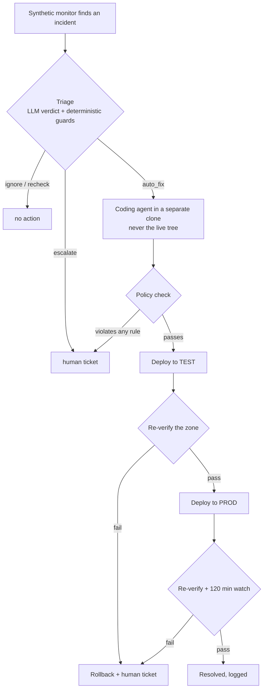

# Where I draw the autonomy boundary for a self-healing agent

This is the policy of the auto-heal agent that runs against one of my production SaaS platforms. A synthetic monitor (Playwright) finds a broken page or flow, and a headless coding agent proposes a fix. The question this document answers is **what that agent may do without a human**.

## The rules (all must hold)

| Rule | Value | Why |
|---|---|---|
| Kill switch | one setting | The fastest rollback is turning the feature off. |
| Daily budget | 8 fix jobs / day | It caps damage and cost from a bad loop. |
| Circuit breaker | pause after 3 consecutive failures | Repeated failure means the agent is wrong about the system, not unlucky. |
| Minimum confidence | 0.7 from triage | Low-confidence fixes go to a human with the analysis attached. |
| Files touched | ≤ 3 | Real fixes for the incidents this targets are small; big diffs are a smell. |
| Lines changed | ≤ 60 | Same reasoning. |
| Paths | allow-listed prefixes; a forbidden-path regex | Payments, auth, config, migrations and anything touching secrets are out of scope by construction. |
| Database | no schema or data changes, ever | No rollback story is cheap enough. |
| Lint | must pass on every changed file | It is a cheap, deterministic floor. |
| Attempts | ≤ 2 per incident | After that it becomes a human problem. |
| Order | TEST → re-verify → PROD → re-verify + watch | The same monitor that found the incident has to confirm the fix, twice. |

For incidents raised by people (support tickets), the agent never deploys. It opens a **draft PR** on a `claude/fix-*` branch for human review. Before any push it checks:
- only the files it changed are staged;
- the diff passes a secret scan;
- a per-hour PR cap has not been reached.

## Decisions I'd defend in review

- **The model's judgment is the first filter, not the last one.** Even a confident "isolated fix" verdict cannot get past the path allow-list, the size limits or the no-DB rule. Those are code, not prompt.
- **The agent works on a copy.** It edits a separate clone and returns a patch. A different, privileged process applies it, with backups and a rollback. The coding agent itself has no write access to the live tree.
- **Same signal in, same signal out.** A fix is "done" only when the monitor that raised the incident passes again, on TEST and then on PROD. "The agent said it fixed it" counts for nothing.
- **Fail closed.** If the budget, lease or verification state cannot be read, the agent does nothing.
